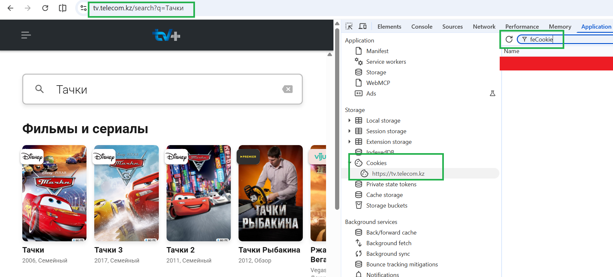

# Kazakhtelecom TV in FxmlKino

[Русская версия](KAZAKHTELECOM.ru.md) · [Back to README](README.md)

**Казахтелеком ТВ** shows the channels, films and series of [tv.telecom.kz](https://tv.telecom.kz/) on the
«FXML Кино» portal. It needs a Kazakhtelecom account.

## Logging in: the session code

To log in, copy your login from a PC browser to the TV. The PC must be on the same network as the TV.

1. On the PC, open [tv.telecom.kz](https://tv.telecom.kz/) and log in to your account.
2. Press **F12** to open the developer tools and go to the **Application** tab (Firefox: **Storage**). If
   you can't see the tab, look under **»**.
3. On the left, open **Cookies** → `https://tv.telecom.kz`.
4. Type `feCookie` in the **Filter** box at the top, double-click the value in the row that remains and
   press **Ctrl+C**.

   

5. On the TV, open **Казахтелеком ТВ** → **Войти**. The page shows an address such as
   `http://192.168.1.10:8787/kt/login`. Open that address in the PC browser.
6. Paste the value into **Код сессии**, press **Сохранить**, then press **Я вошёл** on the TV.

Good to know:
- The code gives access to your account, so don't share it or post it anywhere.
- It stops working if you press **Выйти** on tv.telecom.kz or the session expires. Then repeat these steps.
- For a second TV, open its login page and paste the same code. The first TV's login page shows it with a
  **Скопировать код** button.
- **Выйти** in FxmlKino removes the code from this TV only. You stay logged in on the site and on other TVs.

## What plays

- Only channels and titles your subscription includes. Some channels play only on a Kazakhtelecom home
  internet connection; the others show the site's message.
- Titles protected by DRM, including Disney and Okko, don't play in Fork browser. They show a message
  instead. Watch them on the site or in the provider's app.
- TV recordings play from the start of the broadcast, but you can't rewind them, and they run on into the
  next programme.
