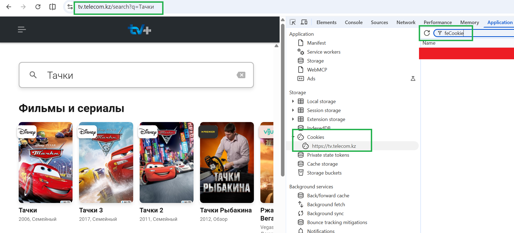

# Казахтелеком ТВ в FxmlKino

[English version](KAZAKHTELECOM.md) · [Назад к README](README.ru.md)

**Казахтелеком ТВ** — телеканалы, фильмы и сериалы [tv.telecom.kz](https://tv.telecom.kz/) на портале
«FXML Кино». Нужен аккаунт Казахтелекома.

## Вход: код сессии

Чтобы войти, нужно перенести вход из браузера на компьютере на телевизор. Компьютер должен быть в одной
сети с телевизором.

1. На компьютере откройте [tv.telecom.kz](https://tv.telecom.kz/) и войдите в свой аккаунт.
2. Нажмите **F12**, чтобы открыть инструменты разработчика, и перейдите на вкладку **Application**
   (в Firefox: **Хранилище**). Если вкладки не видно, поищите её под значком **»**.
3. Слева откройте **Cookies** → `https://tv.telecom.kz`.
4. Вверху в поле **Filter** введите `feCookie`, дважды щёлкните по значению в найденной строке и нажмите
   **Ctrl+C**.

   

5. На телевизоре откройте **Казахтелеком ТВ** → **Войти**. На странице будет адрес вроде
   `http://192.168.1.10:8787/kt/login`. Откройте его в браузере на компьютере.
6. Вставьте значение в поле **Код сессии**, нажмите **Сохранить**, затем на телевизоре нажмите **Я вошёл**.

Полезно знать:
- Код даёт доступ к вашему аккаунту, поэтому никому его не передавайте и нигде не публикуйте.
- Код перестанет работать, если нажать **Выйти** на tv.telecom.kz или если сессия истечёт. Тогда
  повторите эти шаги.
- Для второго телевизора откройте его страницу входа и вставьте тот же код. На странице входа первого
  телевизора он показан вместе с кнопкой **Скопировать код**.
- **Выйти** в FxmlKino удаляет код только с этого телевизора. На сайте и на других телевизорах вход
  остаётся.

## Что воспроизводится

- Только каналы и фильмы из вашей подписки. Некоторые каналы работают только при домашнем интернете
  Казахтелекома; на остальных появится сообщение сайта.
- Фильмы с защитой DRM, в том числе Disney и Okko, в Fork browser не воспроизводятся: вместо них появится
  сообщение. Их можно смотреть на сайте или в приложении провайдера.
- Записи эфиров начинаются с начала передачи, но перематывать их нельзя, а в конце они переходят в
  следующую передачу.
