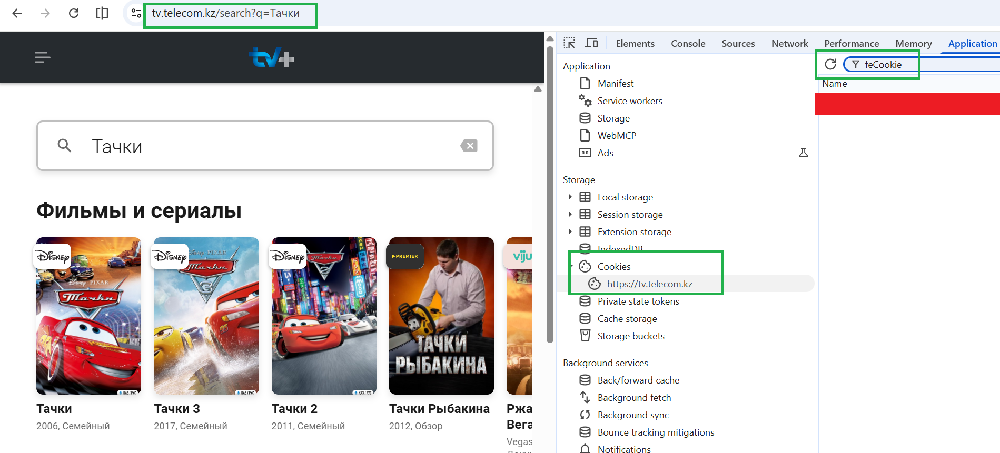

# FxmlKino for Samsung, LG and Android TVs

[Русская версия](README.ru.md)

**FxmlKino** shows two movie sites, [HDRezka](https://kz.rezka.biz/) and [Kinogo](https://sim.kinogo.tm/),
on Samsung (Tizen) and LG (webOS) Smart TVs, and on Android TV, TV boxes and phones, as
[Fork browser](https://wiki.forkbrowser.top/wiki/FXML) (FXML) pages. LG TVs: see
[LG TVs (webOS)](#lg-tvs-webos). Android: see
[Android TV, TV boxes and phones](#android-tv-tv-boxes-and-phones).

- No ads and no account needed.
- Pick the season and the voice-over; its episodes then play one after another. Quality up to 1080p:
  videos start at Fork browser's **Settings → Video & Audio → Video quality** (720p by default) and can
  be switched in the player.
- Episodes start quickly: the TV keeps what it has read from the sites for a while and prepares the
  next episode while one plays.
- Everything Fork browser needs is inside the app: it no longer loads its engine from Fork's servers.
- The sites are read **by the TV itself**: once installed, it needs no PC and no server. If the
  sites open on your computer, they should work on your TV too.
- QINO ТВ, the live TV channels, films, series and TV recordings of [qino.live](https://qino.live/). It needs a qino.live account; you
  log in with an SMS code, in a phone or PC browser or on the TV.
- Kazakhtelecom TV, the channels, films and series of [tv.telecom.kz](https://tv.telecom.kz/). It needs
  a Kazakhtelecom account; you log in with a session code from a PC, see
  [Kazakhtelecom TV: the session code](#kazakhtelecom-tv-the-session-code).

Tested on a UE65TU7500 (2020, Tizen 5.5).

## Installing on a Samsung TV

There are three ways. All of them need **Developer Mode** on the TV once (see
[Developer Mode](#developer-mode) below).

| Way | TVs | Notes |
|---|---|---|
| **1. TizenBrew Installer** (recommended) | any Samsung TV from 2017 on, including 2022+ | One program on your PC or Android phone; it creates the certificate for **your** TV itself. |
| 2. TizenBrew module | any TV that already has TizenBrew | No PC needed, no signing. |
| 3. This repository's `install.bat` | 2017–2021 (Tizen 3–6.5); 2022+ only if listed in the author's certificate | Windows only. |

### 1. TizenBrew Installer (recommended)

1. Turn on [Developer Mode](#developer-mode) with your PC's IP as **Host PC IP**.
2. Download [TizenBrew Installer](https://github.com/reisxd/TizenBrewInstaller/releases/latest) for
   your system and run it. Connect it to your TV.
3. Choose to install an app **from GitHub** and enter:
   ```
   bizhuka/FxmlKino-TV
   ```
   It downloads `FxmlKino.wgt` from this repository's latest
   [release](https://github.com/bizhuka/FxmlKino-TV/releases/latest) and installs it.
4. On TVs from 2022 on (Tizen 7+) it asks you to sign in to a Samsung account and creates a
   certificate for your TV. Follow the on-screen steps.

### 2. TizenBrew module

If TizenBrew is already on the TV: press the **green** button in TizenBrew, choose **Add GitHub
Module** and enter `bizhuka/FxmlKino-TizenBrew`. See
[FxmlKino-TizenBrew](https://github.com/bizhuka/FxmlKino-TizenBrew).

### 3. Windows installer from this repository

1. **Download** this repository: **Code → Download ZIP**, then unzip it.
2. Turn on [Developer Mode](#developer-mode) with your PC's IP as **Host PC IP**.
3. Double-click **`install.bat`** in the unzipped folder. Choose **1**, then your TV. The installer
   finds the TV, installs **FxmlKino** and starts it. Option 3 installs on all ready TVs at once.

TVs from 2017 to 2021 (Tizen 3 to 6.5) install it as is. TVs from 2022 on (Tizen 7+) only accept
it if their **device ID** is in the author's Samsung certificate. The installer saves the TV's ID in
**`devices.txt`**: send it to the author (open an issue here), or use way 1 instead.

### Developer Mode

Once per TV:

1. Open **Apps** (Home → Apps).
2. Type **1 2 3 4 5** on the remote. On a Smart Remote, press the **123** button for digits.
3. Set **Developer mode** to **On** and enter **Host PC IP**: the IP of the PC (or phone) you
   install from. On Windows, `ipconfig` shows it ("IPv4 Address").
4. Restart the TV: hold the power button until it turns off and on again.

## LG TVs (webOS)

`FxmlKino.ipk` (in this repository and in each [release](https://github.com/bizhuka/FxmlKino-TV/releases/latest))
is the same app for LG webOS TVs, with the same on-TV parser.

1. **Developer Mode on the TV** (once):
   1. Create an account on the [LG webOS TV developer site](https://webostv.developer.lge.com/).
   2. On the TV, install **Developer Mode** from the LG Content Store, open it and sign in with
      that account.
   3. Turn **Dev Mode Status** on; the TV restarts. Open the app again and turn **Key Server** on.
      It shows a 6-character **passphrase** at the bottom left.
2. **Install** with [webOS Dev Manager](https://github.com/webosbrew/dev-manager-desktop/releases/latest)
   (Windows, macOS, Linux):
   1. Add the TV: its IP (TV: Settings → General → Network → Network Status) and the passphrase.
   2. Open **Apps**, install `FxmlKino.ipk`, then start **FxmlKino** on the TV.
3. The splash screen shows `FXML: сервис работает` at the bottom left when the parser runs, and the
   FXML Кино portal opens.

Developer Mode apps stay installed while the Developer Mode session runs (up to 1000 hours).
Open the Developer Mode app and press **EXTEND** from time to time. If the session runs out, the
TV removes the app; install it again after re-enabling Developer Mode. On a rooted TV with
[Homebrew Channel](https://github.com/webosbrew/webos-homebrew-channel), apps stay permanently:
install the `.ipk` there.

<details>
<summary>Command line instead of Dev Manager (LG's webOS CLI)</summary>

```
npm install -g @webos-tools/cli
ares-setup-device -a lgtv -i "host=<TV-IP>" -i "port=9922" -i "username=prisoner"
ares-novacom --device lgtv --getkey          # enter the passphrase
ares-install --device lgtv FxmlKino.ipk
ares-launch --device lgtv com.fxmlkino.tv
```
</details>

## Android TV, TV boxes and phones

`FxmlKino.apk` (in each [release](https://github.com/bizhuka/FxmlKino-TV/releases/latest)) is
[Fork browser](https://wiki.forkbrowser.top/) for Android with FxmlKino built in: the parser runs
inside the app, and the FXML Кино portal opens on start. Android 5.0 or newer. It installs next to
Fork browser, if you have it, and doesn't replace it.

**Phone or tablet:**
1. On the phone, download [`FxmlKino.apk`](https://github.com/bizhuka/FxmlKino-TV/releases/latest/download/FxmlKino.apk).
2. Open it. When Android asks, allow installing apps from this source (your browser or file
   manager), then install.
3. Open **FxmlKino**.

**Android TV or TV box** (one of these):
- The **Downloader** app (by AFTVnews, in Google Play on the TV): enter
  `https://github.com/bizhuka/FxmlKino-TV/releases/latest/download/FxmlKino.apk`, install, and allow Downloader to install apps when asked.
- Copy `FxmlKino.apk` to a USB stick and open it on the TV with a file manager (for example
  X-plore or File Commander).
- From a PC with `adb`: on the TV turn on Developer options → network (USB) debugging, then
  `adb connect <TV-IP>:5555` and `adb install FxmlKino.apk`.

Good to know:
- QINO ТВ login from a phone or PC on the same Wi-Fi: `http://<device-IP>:8787/qino/login` (the
  QINO login page in the app shows the address).
- Fork browser's own messages (first-run hints, a donation window) appear as in Fork browser.
- If Fork browser offers an update, it installs the original Fork browser next to FxmlKino.
  FxmlKino updates come from this repository's releases.

## Kazakhtelecom TV: the session code

To log in to Kazakhtelecom TV, copy your login from a PC browser to the TV. The PC must be on the same
network as the TV.

1. On the PC, open [tv.telecom.kz](https://tv.telecom.kz/) and log in to your account.
2. Press **F12** to open the developer tools and go to the **Application** tab (Firefox: **Storage**).
   If you can't see the tab, look under **»**.
3. On the left, open **Cookies** → `https://tv.telecom.kz`.
4. Type `feCookie` in the **Filter** box at the top, double-click the value in the row that remains
   and press **Ctrl+C**.

   

5. On the TV, open **Казахтелеком ТВ** → **Войти**. The page shows an address such as
   `http://192.168.1.10:8787/kt/login`. Open that address in the PC browser.
6. Paste the value into **Код сессии**, press **Сохранить**, then press **Я вошёл** on the TV.

Good to know:
- The code gives access to your account, so don't share it or post it anywhere.
- It stops working if you press **Выйти** on tv.telecom.kz or the session expires. Then repeat these
  steps.
- For a second TV, open its login page and paste the same code. The first TV's login page shows it
  with a **Скопировать код** button.
- **Выйти** in FxmlKino removes the code from this TV only. You stay logged in on the site and on other TVs.

What plays:
- Only channels and titles your subscription includes. Some channels play only on a Kazakhtelecom
  home internet connection; the others show the site's message.
- Titles protected by DRM, including Disney and Okko, don't play in Fork browser. They
  show a message instead. Watch them on the site or in the provider's app.
- TV recordings play from the start of the broadcast, but you can't rewind them, and they run on into
  the next programme.

## Files

| File | Purpose |
|---|---|
| `install.bat` | The Windows installer (way 3): double-click it. |
| `install.ps1`, `tv-common.ps1` | The installer's code: finds Samsung TVs on the network, checks Developer Mode, installs the app, starts it, and records device IDs. |
| `FxmlKino.wgt` | The app for TVs before Tizen 7 (2017–2021), signed the way [TizenBrew](https://github.com/reisxd/TizenBrew) signs its build for them. TizenBrew Installer re-signs it for 2022+ TVs. Also attached to each [release](https://github.com/bizhuka/FxmlKino-TV/releases). |
| `FxmlKino-tizen7.wgt` | The app for Tizen 7+ (2022+), signed with the author's Samsung certificate for the TVs it lists. |
| `FxmlKino.ipk` | The app for LG webOS TVs (see [LG TVs](#lg-tvs-webos)). |
| `FxmlKino.apk` | Release only (not in this repository): the Android app (see [Android](#android-tv-tv-boxes-and-phones)). |
| `sdb.exe` | Samsung's Tizen SDK device tool, which the installer uses to talk to the TV. |
| `README.txt` | Short instructions (Russian). |

This repository is generated by the author's build tool. The app's source isn't published here.
